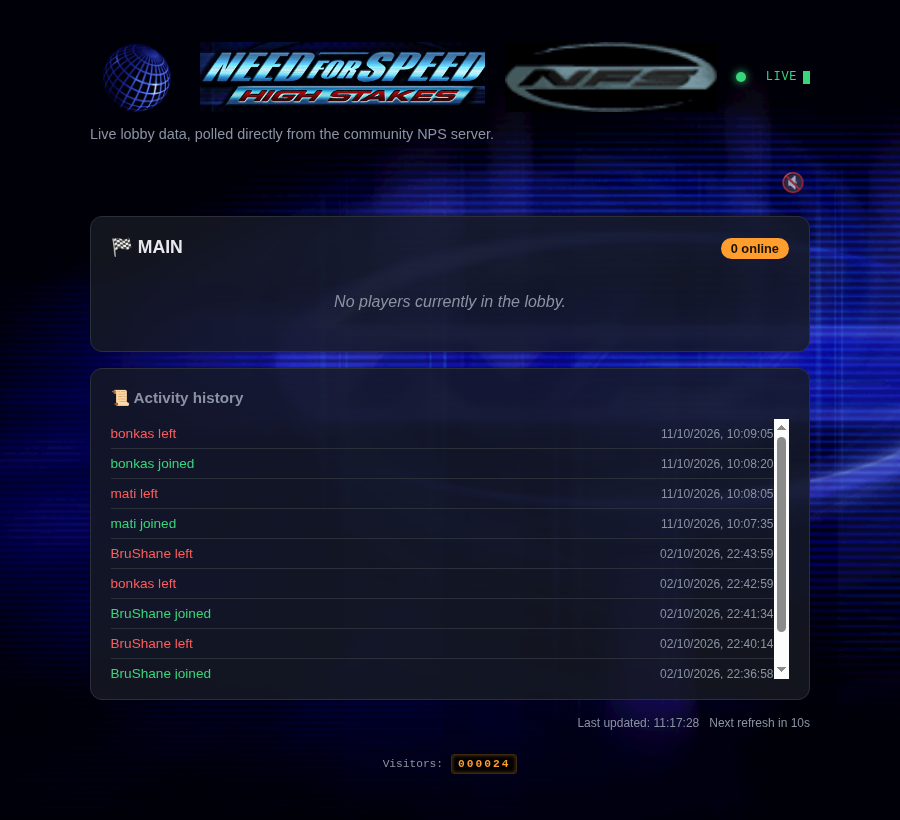

# NFSHS EAOR Web Server

A live lobby viewer for **Need for Speed: High Stakes (1999)**'s
resurrected online mode.

**Live demo:** [nfs.bonkas.kiwi.nz](https://nfs.bonkas.kiwi.nz)



NFS: High Stakes originally used EA's **NPS ("Network Play System")**
middleware for online play - the same tech EA used for Motor City
Online and other EAOR ("EA Online Racing") titles. EA shut those
servers down in the early 2000s, and the game's online mode sat dead
for two decades. A community client-side patch revives it by
redirecting the game's original, unmodified NPS libraries to a
privately-run server, bringing EAOR back online with custom netcode.

This project reverse-engineers that protocol well enough to show
**who's currently online** - without needing the game running, a
login, or any credentials - and serves it as a small website:

- Live MAIN lobby roster (usernames + rank)
- Join/leave activity history, so you can see what happened even if
  you weren't watching
- An optional "someone joined" sound
- A nostalgic page-view counter, because why not

## Privacy by design

The upstream community server has **no authentication on reads** - it
will hand back any player's rank, real IP, and hostname to anyone who
asks, no login required. This app deliberately does **not** re-publish
that: only username and rank are ever exposed publicly. See
[`deploy/backend.py`](deploy/backend.py) for exactly what's scrubbed
and why.

## Running it

Everything needed to run or deploy this lives in [`deploy/`](deploy/):

```
cd deploy
python run.py
```

Zero manual setup - it builds its own virtual environment and installs
dependencies on first run. See [`deploy/README.md`](deploy/README.md)
for Docker and systemd options for hosting it somewhere permanent.

## How it works

`deploy/nps_client.py` is a small, dependency-free NPS protocol client
built from a live packet capture of the real game client. It sends a
single passive, stateless query (`NPS_GET_USER_LIST`) - no login, no
room-join, no footprint on the real shared lobby. `deploy/backend.py`
wraps that in a small FastAPI app with a short cache (so public traffic
to the website can't turn into a flood against a community server this
project doesn't control), and a plain HTML/JS frontend polls it.

## Related projects

- [rustymotors/server](https://github.com/rustymotors/server) - a
  from-scratch NPS/MCOTS reimplementation for Motor City Online, useful
  as a protocol reference.
- [americusmaximus/AZHS](https://github.com/americusmaximus/AZHS) /
  [AZMCO](https://github.com/americusmaximus/AZMCO) - open-source
  client-side reimplementations via binary reverse engineering.

## Status

Unofficial fan project, not affiliated with EA. Depends entirely on a
community-run server staying up - if it goes down, this has nothing to
show.
